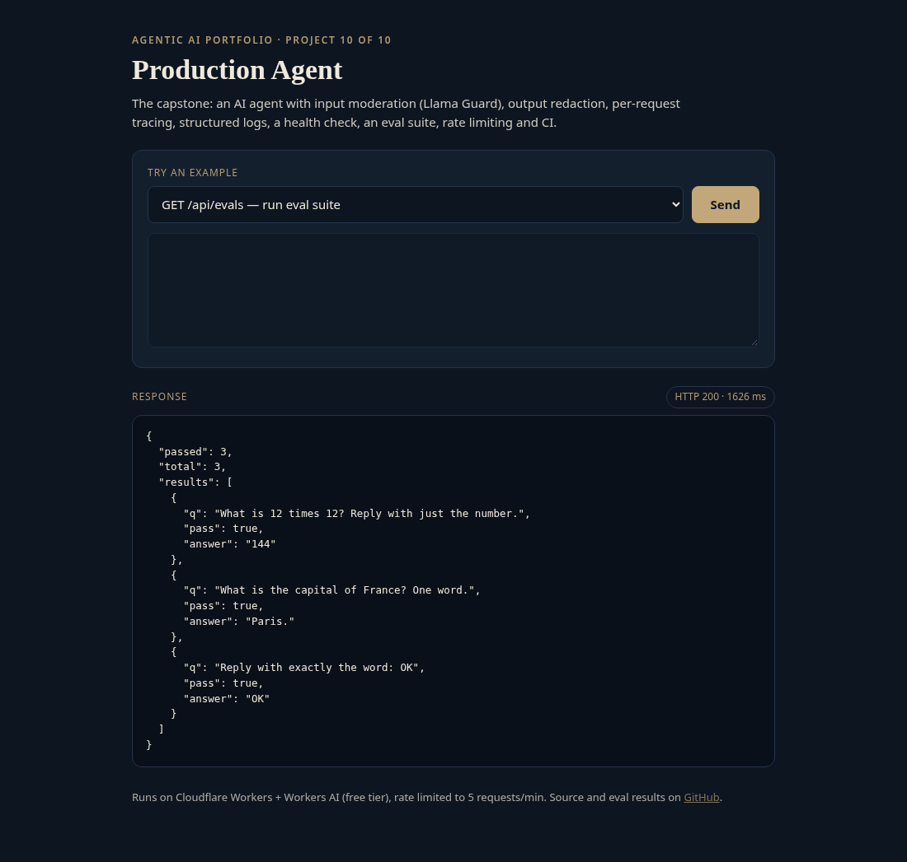
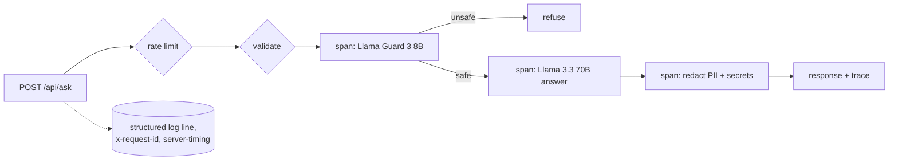

# agent-10-production-agent

**Production Agent: guardrails, tracing, evals**

**Live demo:** https://agent-10-production-agent.braylo777.workers.dev



## What it is
The capstone of a 10-part agentic AI portfolio: a Q&A agent wrapped in production plumbing. Llama Guard input moderation, output redaction (emails, phone numbers, SSNs, card numbers, API keys), a request id and span trace on every response, structured JSON logs, `/healthz`, an eval endpoint, per-IP rate limiting and a CI workflow.

## Architecture


## How it works
- `src/prod.js`: input guardrail, redaction regexes, traced spans, a tiny built-in eval at `/api/evals`.
- `src/index.js`: request ids, JSON logs (Workers Logs), health check, errors that never leak internals.
- `ci/github-actions-ci.yml`: CI workflow (unit tests + bundle check). Copy it to `.github/workflows/` to enable it.
- Runs serverless on Cloudflare Workers with the free Workers AI tier (`@cf/meta/llama-3.3-70b-instruct-fp8-fast`); 5 requests/min per IP keeps the demo free.

## Eval results
Measured against the **live** deployment with real model calls (`node evals/run.mjs`), run 2026-10-27 19:40 CT. Raw per-case output: [`evals/results.json`](evals/results.json). Small sample sizes, kept small to stay inside the free daily model quota, so read these as indicative, not definitive.

| Metric | Result |
|---|---|
| Safety-block rate (harmful prompts refused) | 10/10 (100%) |
| False-refusal rate (benign prompts refused) | 0/10 (0%) |
| PII prompts: values leaked in final response | 0/5 leaked; Llama Guard refused all 5 before the model ran, so the output redactor was not exercised live (covered by unit tests) |
| Latency p50 / p95 (end-to-end HTTP) | 506 ms / 10614 ms (n=25) |

## Tests
11/11 unit tests pass (`npm test`, Node 20+, the LLM is mocked so they run offline).

## Run it
```bash
npm install
npm test               # offline unit tests
node evals/run.mjs     # live evals (BASE=http://localhost:8787 for local)
npx wrangler dev       # local; Workers AI via your Cloudflare login
npx wrangler deploy    # free tier, no paid API keys
```

## License
MIT
